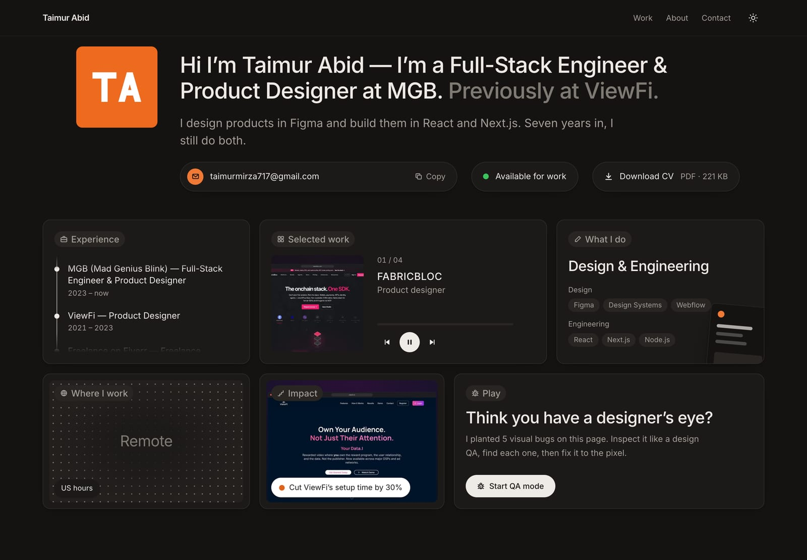

# Taimur Abid — Portfolio

Personal site of Taimur Abid, Full-Stack Engineer & Product Designer. I design products in Figma and build them in React and Next.js.

**Live:** [taimur-portfolio-1.vercel.app](https://taimur-portfolio-1.vercel.app)



## What's inside

- **Bento homepage.** Intro, experience, selected work, skills, impact and contact, with a one-click Download CV.
- **Case studies.** One MDX file per project in `content/work`, rendered at `/work/[slug]`, with real screenshots of each live site.
- **QA mode.** A design-QA game: five visual bugs are planted on the page, and you inspect it like a designer, find each one and fix it to the pixel. Your best time is saved.
- **Don't press this.** The homepage cards collapse under real physics. Drag each one back home against the clock, or hit "Put it back for me". It's hidden on small screens and when reduced motion is on.
- **Sketch → Component.** Draw nested boxes like a wireframe. It works out rows, columns, spacing and what each box probably is, then writes the React + Tailwind code live.
- **Built for people and machines.** Static pages, generated OG images, a sitemap, robots, JSON-LD, plus `llms.txt` and `llms-full.txt` for AI assistants.
- **Accessible motion.** All looping animation runs on one clock, with a pause button (WCAG 2.2.2), and respects `prefers-reduced-motion`.

## Tech stack

| Area      | Choice                                                             |
| --------- | ------------------------------------------------------------------ |
| Framework | Next.js 15 (App Router, fully static) + React 19                   |
| Language  | TypeScript, strict                                                 |
| Styling   | Tailwind CSS v4 with design tokens in `app/globals.css`            |
| Content   | MDX via `next-mdx-remote`, frontmatter validated with Zod          |
| Media     | `next/image` (AVIF/WebP), `next/font`, `next/og` for social images |
| Quality   | ESLint, Prettier, Vitest                                           |
| Hosting   | Vercel                                                             |

No CMS, database or UI kit.

## Getting started

Requires Node.js 20.9 or newer.

```bash
npm install
npm run dev
```

Open [http://localhost:3000](http://localhost:3000).

## Scripts

| Command                         | What it does                                                             |
| ------------------------------- | ------------------------------------------------------------------------ |
| `npm run dev`                   | Dev server with Turbopack                                                |
| `npm run build` / `npm start`   | Production build and server                                              |
| `npm run check`                 | Typecheck, lint, format check and tests: run this before a PR            |
| `npm test`                      | Unit tests (Vitest)                                                      |
| `npm run format`                | Format everything with Prettier                                          |
| `npm run project-images [slug]` | Recapture a project's cover and screenshots from its live site           |
| `npm run avatar`                | Generate avatar options (`-- --force` also rewrites `public/avatar.jpg`) |

`project-images` drives your installed Google Chrome through `puppeteer-core`. Set `CHROME_PATH` if Chrome isn't in the default macOS location.

## Project structure

```
app/                 Routes: home, /work/[slug], 404, OG images, sitemap, robots, llms.txt
components/
  sections/          Page sections (bento grid, selected work, about, contact, case study parts)
  mdx/               Components available inside case-study MDX (CaseSection, Figure)
  qa/  break/        QA mode and "Don't press this"
  playground/        Sketch → Component
  ui/                Small shared building blocks
content/work/        One .mdx file per case study
lib/                 Site config, content, MDX loading, motion clock, game and sketch logic
public/              CV PDF, avatar and project images (public/work/<slug>/)
scripts/             Project-image and avatar generators
```

## Editing content

- **Name, role, links, email:** `lib/site.ts`
- **Intro, about, skills, experience, education:** `lib/content.ts`
- **CV:** replace `public/Taimur-Abid-CV.pdf` with the new PDF (same file name). Every Download CV button picks it up, with its file size, on the next build.

### Adding a case study

1. Create `content/work/<slug>.mdx`:

   ```mdx
   ---
   title: Project name
   summary: One line for the card (120 characters max).
   role: Product designer
   tags: [Mobile, Design systems] # 1–4 tags
   order: 5 # position on the homepage
   link: https://example.com # optional
   cover:
     src: /work/<slug>/cover.jpg
     alt: Describe what the image shows
   ---

   <CaseSection title="Overview">Text…</CaseSection>

   <Figure src="/work/<slug>/screen-01.jpg" alt="…" caption="…" />
   ```

2. Put its images in `public/work/<slug>/`. Alternatively, add the site to `scripts/project-images.mjs` and run `npm run project-images <slug>`.
3. Run `npm run build`. Frontmatter is validated, so a missing field or alt text fails the build with a clear message.

The page, sitemap entry, OG image and `llms.txt` entry are generated automatically.

## Deployment

Pushes to `main` deploy to Vercel. Set `NEXT_PUBLIC_SITE_URL` if the site moves to a custom domain, so canonical URLs, the sitemap and OG images point at it.

## License

The code is free to read and learn from. The content (text, CV, images and case studies) is © Taimur Abid and may not be reused.
